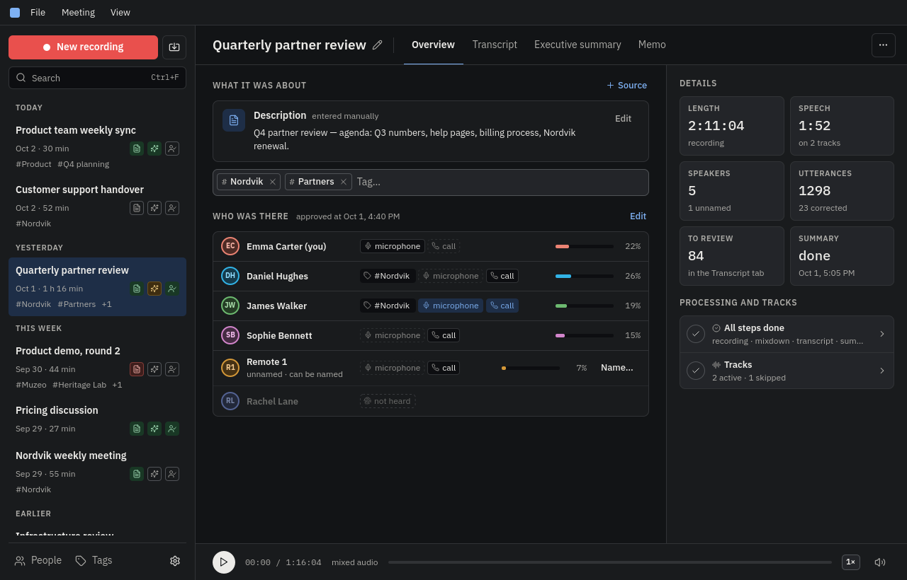
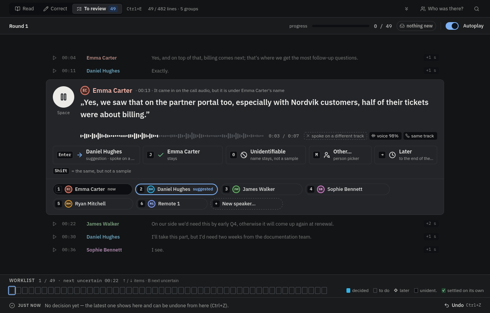
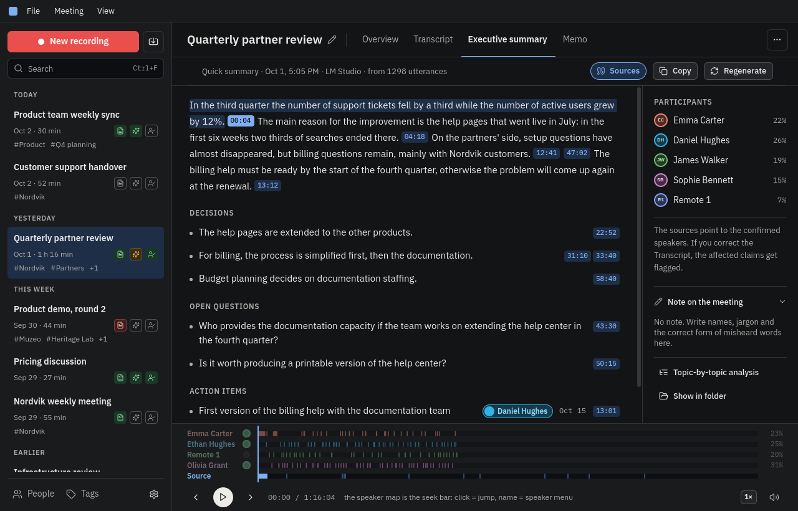

# Tanara

**An open-source meeting recorder and post-meeting hub. Records on your computer, reminds you when a meeting starts, and routes the recording to the transcription, speaker-identification and summary tools you choose — local or cloud, step by step.**

Tanara is a native desktop app (Qt 6, C++, QML) for Linux and Windows. It records your meetings locally, helps you find out who said what, lets you fix the mistakes of automatic transcription and diarization, learns voices over time, and turns the result into summaries. The UI is available in English and Hungarian.

**Record locally. Choose your tools. Keep control.**

---

## Just another meeting recorder?

On its own, yes: a recorder with a watcher that notices when a call starts and offers to record it. The point is what happens after the recording.

Transcription quality varies enormously between languages. If your language has a small user base, open-source speech recognition and diarization are often unusable, and even commercial products struggle. If the language is also hard, you are almost out of options. Hello, fellow Hungarian, Finnish, Turkish, Slovak and Slovenian speakers.

Tanara does not try to build yet another speech model. It connects the pieces and does the things the better-quality tools do not:

- **Routes each processing step where you want it**: transcription, speaker separation, speaker recognition, summary and tag suggestions can each run on your machine, with an external provider and your own key, or (soon) through Tanara Cloud.
- **Works fully offline if you want**: a local Whisper-compatible server plus Tanara's own speaker separation gives a transcript with speakers without any cloud service.
- **Identifies participants with local voice fingerprinting**, using open-source speaker models you can pick and swap. The voiceprints never leave your computer.
- **Lets you fix diarization mistakes quickly**, and learns from every correction so the next meeting needs fewer of them.
- **Builds on proven cross-platform open-source projects** such as FFmpeg, ONNX Runtime, whisper.cpp-style servers and the pyannote segmentation model instead of reinventing them.

I started Tanara after switching to Linux. I had been using [Jamie](https://www.meetjamie.ai/), a great choice if you want a streamlined assistant, but it was not available on Linux, and I was staffed with meetings. Most alternatives cost 20–60 € a month and skip Linux too.

---

## How it works

1. **Record.** Tanara captures your microphone and the call audio as separate tracks on your computer. The `tanara-watcher` tray app notices when a meeting starts and reminds you to record.
2. **Transcribe.** The mixdown goes to the transcription provider you chose for this step: a local Whisper-compatible server, Soniox with your own key, or Tanara Cloud.
3. **Separate the speakers.** Soniox does this itself. For Whisper, Tanara's local diarization (a pyannote segmentation model plus the speaker-embedding models, all ONNX, all on your machine) tells who speaks when.
4. **Identify speakers.** Local voice fingerprints match transcript segments to people you already know; track energy tells the microphone side from the call side.
5. **Review and correct.** A focused review flow shows only the doubtful lines, one at a time, with a suggestion and one-key decisions. Every decision teaches the voice models.
6. **Summarize.** The corrected transcript goes to an OpenAI-compatible endpoint (a local LM Studio, or a service with your key) with your own prompts, and comes back as a summary with source references into the transcript.

Each component does what it is good at. Tanara connects them into one workflow and keeps the data on your disk.

---

## What you can do today

### Recording and tracks
- Record meetings locally with several sources at once: microphone, call audio, system audio.
- Get reminded by the watcher when a call starts; one click opens the floating recorder.
- Tracks switched on later, dropped devices and gaps are handled; a mixdown is created for playback and transcription.

### Transcription with the provider you choose
- **Local, no key needed:** any Whisper-compatible server (for example whisper.cpp's server) on your machine or your network. Tanara sends the meeting's context (names, terms, notes) as the Whisper prompt and warns you when it would not fit the model's prompt budget.
- **Soniox** with your own key: for us the only option so far for high-quality, affordable transcription in hard languages, with speaker separation built in.
- **Local speaker separation** for transcribers that do not separate speakers: a pyannote segmentation model and the speaker-embedding models run on your machine; the downloads are verified by SHA-256.
- The provider abstraction is open; adding another service is a contribution we welcome.

### Speaker identification that improves over time
- Local voiceprints with open-source speaker-embedding models: WeSpeaker ResNet34-LM (recommended default), CAM++ (fallback), ERes2NetV2 (optional). Two can run together and their results are fused.
- Microphone-side versus call-side detection from the tracks themselves, including manual track assignment per person.
- A people directory with names, aliases, tags, notes, voice samples and meeting history.

### Reviewing the transcript
- **Read**, **Correct** and **To review** modes. Correction has a speaker rail: click or drag a line to another speaker; hold Shift to say "right speaker, but do not use it as a voice sample".
- **To review** shows only the doubtful lines in a focused card: hear the line, see the suggestion, decide with one key. Lines the system resolved on its own are skipped; strong groups come as one proposal with spot checks.
- A sweep mode plays the meeting and stops at doubtful lines so you can correct while listening.
- Undo across everything, a visible "just now" row with the last decision, and a sample meter per speaker.

### Summaries and metadata
- Executive summary, decisions, open questions, action items and a memo, each with references back to the transcript.
- Your own prompts on the local and own-key routes (single-step, part notes and merge for long meetings, topic analysis for complex ones).
- Tags on meetings and on people; tags learned from who attends what.
- A command-line tool (`tanara-cli`) for the same operations in scripts, including `--run local|external|cloud` per run.

### Settings that follow the processing chain
The Settings window lists the steps in the order they run — transcription, speaker separation, speaker recognition, summary, tag suggestions — and each step has one question first: **where should it run?** Locally, with an external provider, through Tanara Cloud, or ask every time. If you choose "ask", the start button offers the options with the expected time and cost before anything runs.

---

## Do I need Tanara Cloud?

**No.** Tanara works with the providers you configure, including services on your own infrastructure. You are not required to use Tanara Cloud for anything.

Setting up transcription endpoints, choosing models and tuning prompts is inconvenient if you just want notes from a meeting. That is why we are building **Tanara Cloud**: a managed service where you choose a level (fast or accurate) through one account, and Tanara picks the providers behind it. It is developed separately from the open-source app and is not available yet; the client already shows where it will plug in.

A few things are decided already:

- **Pay per use.** You pay only for what you use, with a cost estimate before every run and the actual charge afterwards. Our target is to keep transcription and summary together **under 1 € per meeting hour**, even for the hardest languages. These figures are development goals, not current pricing.
- **Fixed templates on the cloud route.** Through Tanara Cloud the summary runs with the service's own templates and your options (language, length, focus); free-text prompts stay on the local and own-key routes. This keeps the shared service safe from prompt injection and keeps its costs predictable.
- **Nothing is forced.** If you do not want to pay for transcription or summaries, you are not forced to; the app stays free and local.

---

## Privacy and data control

Meeting recordings are among the most sensitive data you handle at work. Where it goes should be your deliberate choice.

- Recording, voice fingerprints and the people directory stay on your computer. Speaker recognition is local only; there is no cloud route for it.
- Transcription, speaker separation and summarization only leave your machine if you choose an external provider or Tanara Cloud for that step. With local services, everything stays local.
- For Tanara Cloud we choose providers carefully: GDPR compliance, EU-based processing where applicable, no data retention beyond processing and abuse prevention, no sneaky transfers outside the EU.

**Local recording does not automatically mean local transcription.** If you pick a cloud provider, your audio or transcript goes to that provider under its terms. Tanara shows the choice for every step instead of hiding it behind a button.

---

## Platforms and status

Tanara is **pre-alpha**. The client is roughly 70% complete; UI details and workflows may still change.

| Platform | Status | Notes |
|---|---|---|
| **Windows 10 / 11** | Pre-alpha installer | Usable in daily work by power users. |
| **Linux** | Build from source | Used daily by the author. Flatpak or similar planned. |
| **macOS** | Untested | No hardware yet; Qt 6 should make it possible. Help welcome. |

Already stable in daily use: recording and the watcher, Soniox transcription, transcript correction and the review flow, summaries, people and voiceprints.

New and still being calibrated: the fully local path (Whisper-compatible transcription with Tanara's own speaker separation), the per-step routing in Settings.

Still maturing: packaging, some review details, macOS, Tanara Cloud.

---

## Screenshots

<!-- Mock data only: a fictional meeting with fictional people. -->

**Overview** of a finished meeting: who was there, on which track, with their share of speech; tags, description, processing state.

**Transcript review**: only the doubtful lines, one at a time, with the suggestion, the evidence and one-key decisions. Shift makes any decision "right speaker, but not a voice sample".

**Executive summary** with sources: every claim, decision and action item links back to the transcript; correcting a speaker flags the affected claims.

---

## Getting started

- **Source:** [github.com/RemedIT-Hungary/Tanara](https://github.com/RemedIT-Hungary/Tanara)
- **Build:** [docs/BUILD.md](docs/BUILD.md) covers the Linux (Fedora) and Windows (MinGW) developer build, the CMake options, the tests and the release packages; [docs/macos.md](docs/macos.md) collects what we know about macOS.
- **Issues:** [GitHub Issues](https://github.com/RemedIT-Hungary/Tanara/issues)

---

## Contributing

Tanara is MIT-licensed and contributions are welcome, especially:

- macOS build and testing;
- Linux packaging (Flatpak or similar);
- transcription provider integrations;
- language support beyond English and Hungarian;
- speaker-identification and review workflow improvements;
- documentation.

Please open an issue before a larger change so we can coordinate.

---

## License

Tanara is licensed under the **MIT License**. See [LICENSE](LICENSE). Third-party components and their licenses are listed in [THIRD_PARTY_NOTICES.md](THIRD_PARTY_NOTICES.md).
